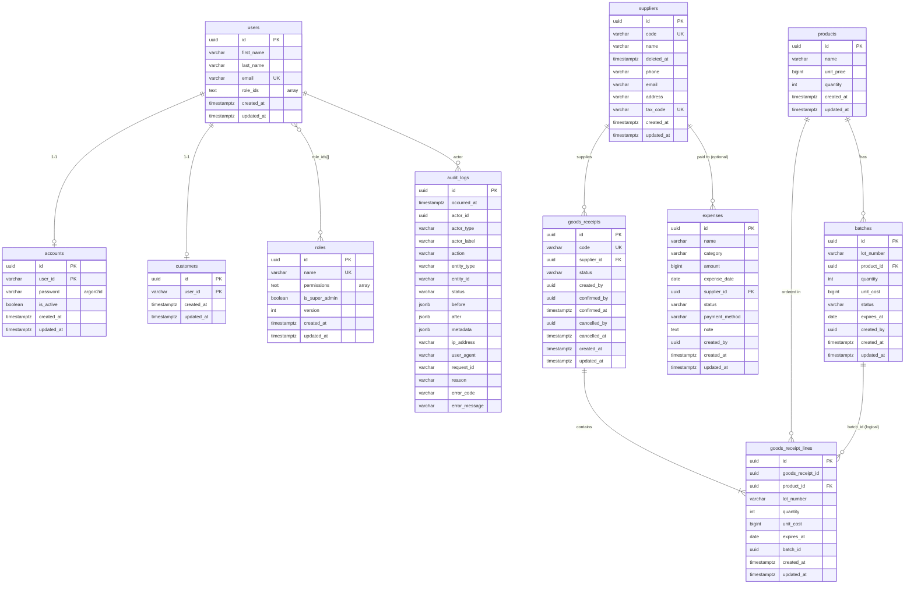
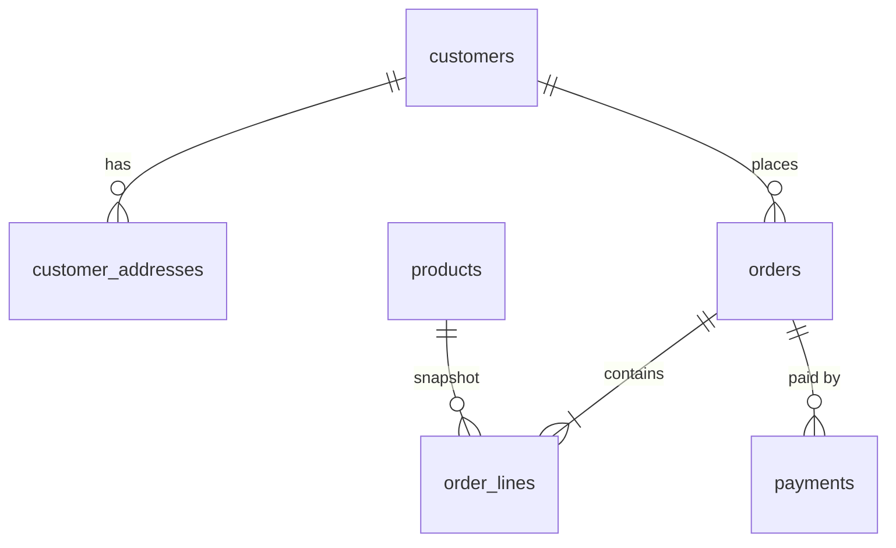

# Data model

## 1. Nguyên tắc

- Mỗi bảng có khóa chính; hầu hết dùng UUID v4 sinh từ domain.
- Thời gian lưu `timestamptz`; ngày nghiệp vụ (hạn dùng, ngày chi phí) dùng
  `date`.
- Tiền lưu `bigint` (VND), không dùng `numeric`/float sau migration
  `Migration20261114000000_money_to_bigint`.
- Không xoá cứng dữ liệu nghiệp vụ quan trọng; dùng cờ xoá mềm (`deleted_at`),
  trạng thái (`cancelled`) hoặc bảng audit.
- `audit_logs` là **append-only**, được ghi trong cùng transaction với nghiệp vụ.
- Sai khác giữa domain và DB được xử lý ở domain; DB giữ ràng buộc tối thiểu.

## 2. ERD hiện tại



> `batches` → `goods_receipt_lines.batch_id` là quan hệ logic, **không có FK**
> trong DB. `users` → `roles` cũng là quan hệ logic qua mảng `role_ids`.

## 3. Mô tả bảng

### `users`

Người dùng nội bộ và chủ tài khoản khách hàng.

| Cột | Kiểu | Ghi chú |
|---|---|---|
| `id` | uuid PK | |
| `first_name`, `last_name` | varchar | |
| `email` | varchar unique | Đăng nhập |
| `role_ids` | text[] | GIN index; không FK |
| `created_at`, `updated_at` | timestamptz | |

### `accounts`

Thông tin đăng nhập, tách khỏi `users`.

| Cột | Kiểu | Ghi chú |
|---|---|---|
| `id` | uuid | PK phức hợp `(id, user_id)` |
| `user_id` | varchar | Trỏ `users.id` (không FK) |
| `password` | varchar | Hash Argon2id |
| `is_active` | boolean | |
| `created_at`, `updated_at` | timestamptz | |

> `user_id` là `varchar` trong khi `users.id` là `uuid`; khi query thủ công cần
> cast `id::text`.

### `customers`

Hồ sơ khách hàng tối giản, tạo cùng lúc với đăng ký.

| Cột | Kiểu | Ghi chú |
|---|---|---|
| `id` | uuid | PK phức hợp `(id, user_id)` |
| `user_id` | varchar | Trỏ `users.id` |
| `created_at`, `updated_at` | timestamptz | |

**Còn thiếu:** họ tên, SĐT, ngày sinh, giới tính, địa chỉ.

### `roles`

| Cột | Kiểu | Ghi chú |
|---|---|---|
| `id` | uuid PK | |
| `name` | varchar unique | |
| `permissions` | text[] | GIN index; validate theo catalog |
| `is_super_admin` | boolean | Bỏ qua kiểm tra quyền |
| `version` | int | Optimistic lock |
| `created_at`, `updated_at` | timestamptz | |

### `products`

| Cột | Kiểu | Ghi chú |
|---|---|---|
| `id` | uuid PK, default `gen_random_uuid()` | |
| `name` | varchar | |
| `unit_price` | bigint | VND |
| `sku` | varchar(100) null, unique | Chuẩn hoá chữ hoa; trùng trả `409` |
| `unit` | varchar(50) null | Đơn vị tính |
| `description` | text null | Mô tả |
| `image_url` | varchar(2048) null | Đường dẫn ảnh |
| `warning` | text null | Cảnh báo sử dụng |
| `deleted_at` | timestamptz null | Xoá mềm |
| `created_at`, `updated_at` | timestamptz | |

**Chưa có:** `is_active`; nhóm cố định OTC/TPCN/mỹ phẩm/thiết bị chưa seed —
dùng quan hệ N-N với `categories` thay thế.

### `categories`

| Cột | Kiểu | Ghi chú |
|---|---|---|
| `id` | uuid PK | |
| `name` | varchar(255) unique | |
| `slug` | varchar(255) unique | Tự sinh từ tên nếu client bỏ trống |
| `description` | varchar(255) null | |
| `deleted_at` | timestamptz null | Xoá mềm |
| `created_at`, `updated_at` | timestamptz | |

### `product_categories`

| Cột | Kiểu | Ghi chú |
|---|---|---|
| `category_id` | uuid, FK → `categories.id` | `ON DELETE CASCADE` |
| `product_id` | uuid, FK → `products.id` | `ON DELETE CASCADE` |

Khoá chính là cặp `(category_id, product_id)`; đây là nguồn sự thật của quan hệ
N-N giữa sản phẩm và danh mục.

### `suppliers`

| Cột | Kiểu | Ghi chú |
|---|---|---|
| `id` | uuid PK | |
| `code` | varchar unique | `SUP-0001` |
| `name` | varchar | |
| `phone`, `email`, `address` | varchar nullable | |
| `tax_code` | varchar unique nullable | |
| `created_at`, `updated_at` | timestamptz | |
| `deleted_at` | timestamptz nullable | `null` = còn dùng; có giá trị = đã xoá (soft delete) |

### `goods_receipts`

| Cột | Kiểu | Ghi chú |
|---|---|---|
| `id` | uuid PK | |
| `code` | varchar unique | `GR-0001` |
| `supplier_id` | uuid FK | `ON UPDATE CASCADE`, `ON DELETE NO ACTION` |
| `status` | text | `pending`, `confirmed`, `cancelled` |
| `created_by` | uuid | |
| `confirmed_by`, `confirmed_at` | nullable | |
| `cancelled_by`, `cancelled_at` | nullable | |
| `created_at`, `updated_at` | timestamptz | |

### `goods_receipt_lines`

| Cột | Kiểu | Ghi chú |
|---|---|---|
| `id` | uuid PK | |
| `goods_receipt_id` | uuid | **Không FK** |
| `product_id` | uuid FK | `ON UPDATE CASCADE` |
| `lot_number` | varchar | |
| `quantity` | int | Domain > 0 |
| `unit_cost` | bigint | VND |
| `expires_at` | date | |
| `batch_id` | uuid nullable | Gắn khi xác nhận phiếu |
| `created_at`, `updated_at` | timestamptz | |

Ràng buộc: unique `(goods_receipt_id, product_id, lot_number)`.

### `batches`

Nguồn sự thật của tồn kho.

| Cột | Kiểu | Ghi chú |
|---|---|---|
| `id` | uuid PK | Sinh trước ở handler xác nhận |
| `lot_number` | varchar | |
| `product_id` | uuid FK | |
| `quantity` | int | Số còn lại |
| `unit_cost` | bigint | Giá nhập VND |
| `status` | text | `active`, `expired`, `out` |
| `expires_at` | date | Hạn dùng |
| `created_by` | uuid | |
| `created_at`, `updated_at` | timestamptz | |

Ràng buộc: unique `(product_id, lot_number)`.

### `expenses`

| Cột | Kiểu | Ghi chú |
|---|---|---|
| `id` | uuid PK | |
| `name` | varchar | |
| `category` | text | `rent`, `utilities`, `salary`, `transport`, `marketing`, `office_supplies`, `other` |
| `amount` | bigint | `CHECK (amount >= 0)` |
| `expense_date` | date | |
| `supplier_id` | uuid FK nullable | `ON DELETE SET NULL` |
| `status` | text | `pending`, `approved`, `paid`, `cancelled` |
| `payment_method` | text nullable | `cash`, `bank_transfer`, `card`, `other` |
| `note` | text nullable | |
| `created_by` | uuid | |
| `created_at`, `updated_at` | timestamptz | |

### `audit_logs`

| Cột | Kiểu | Ghi chú |
|---|---|---|
| `id` | uuid PK | |
| `occurred_at` | timestamptz | Thời điểm ghi nhận |
| `actor_id` | uuid nullable | Index |
| `actor_type` | text | `user`, `system` |
| `actor_label` | varchar nullable | Email/label |
| `action` | varchar(100) | `create`, `confirm`, `issue`… |
| `entity_type` | text nullable | `products`, `goods_receipts`… |
| `entity_id` | varchar(255) nullable | |
| `status` | text | `success`, `failed`, `timeout` |
| `before`, `after` | jsonb nullable | Snapshot |
| `metadata` | jsonb | Mặc định `{}` |
| `ip_address`, `user_agent`, `request_id` | varchar nullable | |
| `reason`, `error_code`, `error_message` | nullable | |

Index: `(entity_type, entity_id)`, `(actor_id)`, `(occurred_at)`.

### `mikro_orm_migrations`

Bảng nội bộ của MikroORM, lưu migration đã chạy.

## 4. View `inventories`

Không phải bảng; là view tổng hợp từ `batches`:

```sql
select
  b.product_id,
  sum(b.quantity)::int as total_quantity,
  count(*)::int as batch_count,
  min(b.expires_at) filter (where b.quantity > 0) as nearest_expiry,
  sum(b.quantity * b.unit_cost)::bigint as stock_value,
  max(b.updated_at) as updated_at
from batches b
group by b.product_id
```

Dùng cho màn hình tồn kho tổng hợp, đọc qua `GET /api/inventories`. Chi tiết
lô đọc qua `GET /api/inventories/batches` và `GET /api/inventories/batches/:id`.
`GET /api/products` cũng lấy `stockQuantity` và lọc `inStock` từ view này; bảng
`products` không còn cột `quantity`.

## 5. Quan hệ và ràng buộc chính

| Quan hệ | Kiểu | Ghi chú |
|---|---|---|
| `users` → `accounts` | 1-1 logic | Không FK; account có thể chưa tồn tại |
| `users` → `customers` | 1-1 logic | Tạo khi đăng ký |
| `users` → `roles` | n-n logic | `role_ids` text[] |
| `roles` → permission | n-n logic | `permissions` text[] |
| `suppliers` → `goods_receipts` | 1-n | FK |
| `goods_receipts` → `goods_receipt_lines` | 1-n | Không FK |
| `products` → `goods_receipt_lines` | 1-n | FK |
| `products` → `batches` | 1-n | FK |
| `suppliers` → `expenses` | 1-n optional | FK, set null |
| `users` → `audit_logs` | 1-n logic | `actor_id`, tra cứu theo actor |

Ràng buộc DB đáng chú ý:

- Unique: `users.email`, `roles.name`, `suppliers.code`, `suppliers.tax_code`,
  `goods_receipts.code`, `(product_id, lot_number)`,
  `(goods_receipt_id, product_id, lot_number)`.
- Check: enum của `goods_receipts`, `batches`, `expenses`, `audit_logs`;
  `expenses.amount >= 0`.
- Domain check (không có ở DB): giá bán ≥ 0, số lượng ≥ 0, số lượng xuất > 0,
  không xuất quá tồn.

## 6. Enum

| Enum | Giá trị |
|---|---|
| `GoodsReceiptStatus` | `pending`, `confirmed`, `cancelled` |
| `BatchStatus` | `active`, `expired`, `out` |
| `ExpenseCategory` | `rent`, `utilities`, `salary`, `transport`, `marketing`, `office_supplies`, `other` |
| `ExpenseStatus` | `pending`, `approved`, `paid`, `cancelled` |
| `PaymentMethod` | `cash`, `bank_transfer`, `card`, `other` |
| `ActorType` | `user`, `system` |
| `AuditStatus` | `success`, `failed`, `timeout` |
| `EntityType` | `accounts`, `users`, `customers`, `roles`, `orders`, `products`, `categories`, `suppliers`, `goods_receipts`, `inventories`, `expenses` |
| `ProductCategory` | `otc_medicine`, `supplement`, `cosmetics`, `medical_device` (enum thiết kế, chưa seed vào DB) |

## 7. Dự kiến bổ sung



| Bảng/field dự kiến | Mục đích |
|---|---|
| `products.sku`, `unit`, `description`, `image_url`, `warning`, `is_active` | Thông tin bổ sung của sản phẩm (`is_active` chưa có); hạn dùng nằm ở `goods_receipt_lines`/`batches` |
| `categories`, `product_categories` | Phân loại sản phẩm N-N (đã triển khai) |
| `customers.full_name`, `phone`, `date_of_birth`, `gender` | Hồ sơ khách |
| `customer_addresses` | Nhiều địa chỉ, địa chỉ mặc định |
| `orders`, `order_lines` | Đơn hàng, snapshot giá/tên sản phẩm |
| `payments` | Thanh toán/COD/PSP |
| `stock_movements` | Lịch sử nhập/xuất/điều chỉnh (nếu cần audit sâu hơn) |
| `product_batches` view/API | Đọc lô theo sản phẩm |

## 8. Điểm chưa nhất quán cần xử lý

1. `customers.user_id` là `varchar`, `users.id` là `uuid`; nên đồng bộ kiểu.
2. `goods_receipt_lines` không có FK tới `goods_receipts`; nên thêm để tránh mồ
   côi.
3. `batches.status` chưa được cập nhật tự động khi hết hàng/hết hạn; cần job
   hoặc kiểm tra khi xuất.
4. Nhóm danh mục cố định (`otc_medicine`, `supplement`, `cosmetics`, `medical_device`) chưa được seed; hiện dùng bản ghi `categories` do quản trị tạo.
5. Chưa có bảng đơn hàng/khách nhận hàng, nên chưa thể triển khai giao hàng.
